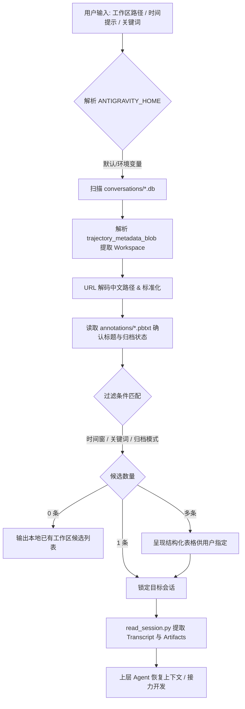

# skill-antigravity-session-locator

> 仓库公开地址：https://github.com/JasonCai2024/skill-antigravity-session-locator  
> 一键克隆命令：`git clone https://github.com/JasonCai2024/skill-antigravity-session-locator.git`

按工作区路径（Workspace / CWD）、更新时间窗、归档状态与对话关键词快速定位本地 Google Antigravity (AGY) 会话，并提取结构化轨迹与实施产物。

---

## 项目简介与核心卖点

Antigravity 的本地会话分布在 `conversations/*.db`（状态与工作区 URI）、`annotations/*.pbtxt`（标题与归档状态）以及 `brain/<id>/`（交互轨迹与产物）中。当开发者或上层 Agent 仅记得「在某个工程目录下、某个大致时间跑过一次任务」时，本技能提供秒级检索与上下文提取：

1. **多维度精准定位**：联合检索工作区路径（自动解码 URL 中文路径）、自然语言时间窗（“昨天下午”、“上周五”）、活跃/归档状态与关键词。
2. **就地归档无缝兼容**：深入适配 Antigravity 的“就地元数据标记”机制，无论会话是否归档均可精准定位，物理路径永不失效。
3. **关键产物秒级调阅**：一键解析提取会话关联的技术方案（`implementation_plan.md`）、验证报告（`walkthrough.md`）及详细工具调用轨迹。

---

## Mermaid 业务流程图



---

## 获取与安装配置

### 1. 放置到技能目录
```powershell
# 克隆至本地
git clone https://github.com/JasonCai2024/skill-antigravity-session-locator.git

# 部署至 Claude Code 项目级或全局技能库
cp -r skill-antigravity-session-locator ~/.claude/skills/
```

### 2. 环境依赖与健康探活
- **环境依赖**：Python 3.8+（仅使用 Python 标准库 `sqlite3`、`json`、`re`、`urllib.parse`、`datetime`、`pathlib`，**零外部 pip 依赖**）。
- **一键健康探活命令**：
```powershell
python scripts/locate_session.py --limit 1
```
*控制台成功输出最近 1 条会话即表示安装成功。*

---

## 使用说明

### 1. 能做什么与怎么对 AI 助理说

| 能力名称 | 自然语言提示词触发话术 (对 AI 助理说) | 底层 CLI 执行命令 |
| :--- | :--- | :--- |
| **按项目定位会话** | “帮我找到昨天在 `E:\BaiduSyncdisk\WorkSpace\ForAgent` 运行的 Antigravity 会话” | `python scripts/locate_session.py --workspace "ForAgent" --time "yesterday"` |
| **检索已归档会话** | “列出所有已归档的 Antigravity 会话，找一下关于‘视频号’的内容” | `python scripts/locate_session.py --archived-only --keyword "视频号"` |
| **查阅实施方案产物** | “提取会话 `967076da-4fa3-475b-9755-819873840fb1` 生成的技术实施计划” | `python scripts/read_session.py --session-id 967076da-4fa3-475b-9755-819873840fb1 --artifacts` |
| **逐轮复现会话细节** | “查看会话 `967076da-...` 的第 3 轮交互与工具调用详情” | `python scripts/read_session.py --session-id 967076da-... --turn 3` |
| **程序化 JSON 消费** | “以 JSON 格式输出工作区 TalentAI 最近的 3 个活跃会话” | `python scripts/locate_session.py --workspace "TalentAI" --active-only --limit 3 --json` |

### 2. 典型实战场景工作流

#### 场景 A：跨智能体接力开发
1. 用户告知 Agent：“继续推进上周在 `TalentAI` 里写了一半的实施方案”。
2. Agent 执行 `python scripts/locate_session.py --workspace "TalentAI" --time "last week"` 定位到 `session_id`。
3. Agent 执行 `python scripts/read_session.py --session-id <id> --artifacts` 读取 `implementation_plan.md`，无缝接力继续编码。

#### 场景 B：排障与决策回溯
1. 某服务上线出现异常，需要查阅当时 Antigravity 调试时的环境命令。
2. Agent 执行 `python scripts/locate_session.py --keyword "npm run build" --limit 3`。
3. 执行 `python scripts/read_session.py --session-id <id> --summary` 快速还原当时执行步骤与工具调用结果。

---

## 凭证安全与隔离规范

- **纯本地只读分析**：本技能仅对本地 SQLite 数据库与 JSONL 文件进行只读扫描，不发起任何外网请求。
- **敏感凭据物理隔离**：不包含任何 Token 或认证密钥。支持通过 `.env` 自定义主目录，`.gitignore` 严格忽略本地 `.env` 与测试数据库。
- **数据无修改保障**：所有查询均采用只读连接或副本探测，绝不污染原应用状态。

---

## 文件目录结构与核心设计决策

### 文件目录结构
```text
skill-antigravity-session-locator/
├── SKILL.md                 # 技能工作说明书
├── README.md                # 统一说明与指引
├── INSTALL.md               # 本地手动部署与验证指南
├── .env.example             # 环境变量示例
├── .gitignore               # 敏感信息与临时缓存忽略规则
├── scripts/
│   ├── locate_session.py    # 多维度扫描与快速定位器
│   └── read_session.py      # 对话轨迹与 Artifact 提取器
└── references/
    ├── antigravity-storage.md         # 存储架构与目录映射详细参考
    └── db-and-annotation-schema.md    # 内部 SQLite 与 pbtxt 字段规格
```

### 核心设计决策
1. **中文 URL 解码优先**：针对 Antigravity 存储中文工作区时做 URL 编码的特性，内嵌 `urllib.parse.unquote`，彻底解决中文路径无法召回问题。
2. **秒级轻量元数据扫描**：优先从 `annotations/*.pbtxt` 提取标题和归档状态，避免每次扫描加载大型数据库或解析完整 JSONL，显著提升检索性能。
3. **零外部依赖**：仅使用 Python 标准库，消除跨环境使用时的包依赖与版本冲突。

---

## 许可证

MIT License
